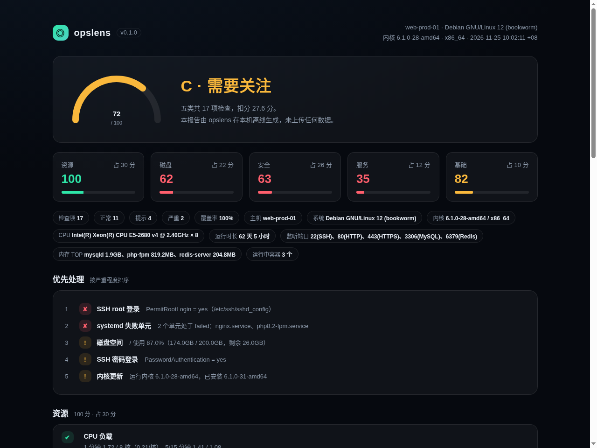

<div align="center">

# opslens · 服务器体检镜

**一条命令，给服务器做一次全身 CT。**

资源 / 磁盘 / 安全 / 服务 / 基础 —— 五类 17 项检查，输出 0-100 健康分、A-F 等级、
分级问题清单，以及一份可以直接发群里、发邮件的 HTML 报告。


</div>



## 为什么又造一个轮子

巡检这件事，现实里通常长这样：

- 上机器 `df -h`、`free -m`、`systemctl --failed` 挨个敲一遍，敲完也记不住上次是多少；
- 装一套 Prometheus + Grafana，为了看一眼磁盘使用率，先得维护三个组件；
- 各家云厂商的体检报告只能在自己控制台看，换台机器就得重来。

`opslens` 想解决的是最小闭环：**一条命令，30 秒内给出「这台机器现在怎么样、哪几件事该先处理」**，并且产出一份人能看懂、能转发的报告。

## 特性

- **零依赖**：只用 Python 标准库，`curl` 下来一个文件就能跑，不污染目标机器的 `site-packages`
- **17 项检查**：资源水位、磁盘与 inode、SSH 与防火墙、systemd 失败单元、DNS/路由/僵尸进程
- **可复算的评分**：每项有固定分值，严重扣满、提示扣 60%，总分 = 100 - 扣分，全部能对上账
- **四种输出**：终端彩色报告 / JSON（喂给监控）/ 自包含 HTML（发给人看）/ Markdown（贴进周报）
- **降级不误判**：非 Linux、容器、没有 systemd、非 root，一律标记「跳过」，既不算分也不报错
- **覆盖率守卫**：可执行项太少（如容器里只剩磁盘一项）时标注「样本不足」，不给虚假满分
- **能进 CI**：`--fail-under 80` 分数不达标直接返回退出码 1

## 快速开始

```bash
# 一行跑，不安装（需要 Python 3.9+）
curl -fsSL https://raw.githubusercontent.com/QKXWX/opslens/main/opslens.py -o opslens.py
python3 opslens.py

# 或者装成全局命令
pipx install git+https://github.com/QKXWX/opslens.git
opslens

# 从源码
git clone https://github.com/QKXWX/opslens.git && cd opslens
python3 opslens.py
```

终端输出大致长这样（`--demo` 演示数据）：

```text
 opslens 0.1.0  ·  服务器体检镜
 web-prod-01  ·  Debian GNU/Linux 12 (bookworm)  ·  内核 6.1.0-28-amd64  ·  x86_64
 采样时间 2026-11-25 09:54:54 +08   耗时 0.0 s

   ████████████████████░░░░░░░░  72 / 100   等级 C · 需要关注

   ✔ 资源  100 / 100 · 占 30 分
   ✘ 磁盘  62  / 100 · 占 22 分
   ✘ 安全  63  / 100 · 占 26 分
   ✘ 服务  35  / 100 · 占 12 分
   ! 基础  82  / 100 · 占 10 分

  安全
    ✘ SSH root 登录     PermitRootLogin = yes（/etc/ssh/sshd_config）
      → root 可直接密码登录，暴力破解的首要目标；改成 PermitRootLogin no（或 prohibit-password）并只用密钥
    ! SSH 密码登录      PasswordAuthentication = yes
      → 密码登录开放，容易被扫爆破；配置密钥登录后设 PasswordAuthentication no

  优先处理
    1. SSH root 登录 PermitRootLogin = yes（/etc/ssh/sshd_config）
    2. systemd 失败单元 2 个单元处于 failed：nginx.service、php8.2-fpm.service
    3. 磁盘空间 / 使用 87.0%（174.0GB / 200.0GB，剩余 26.0GB）
```

## 常用姿势

```bash
opslens                                   # 体检一次
opslens --html report.html                # 顺手生成一份 HTML 报告
opslens --json | jq '.score, .priority'   # 给监控 / 脚本用
opslens --md report.md                    # 贴进周报
opslens --demo                            # 不碰真机，先看看报告长什么样
opslens --only 安全,磁盘                   # 只看最关心的两类
opslens --skip 基础                        # 跳过某类
opslens --rules rules.example.json         # 用自定义阈值（例如磁盘 75% 就报警）
opslens --watch 60                        # 每 60 秒刷新一次，值班屏用
opslens --fail-under 80                   # 低于 80 分返回退出码 1，接 CI
```

| 参数 | 说明 |
| --- | --- |
| `--html PATH` | 生成自包含 HTML（无外链、无 CDN，离线能看） |
| `--json` | 输出机器可读 JSON |
| `--md PATH` | 生成 Markdown 报告 |
| `--only` / `--skip` | 按分类过滤，逗号分隔，中英文名都认 |
| `--rules FILE` | 自定义阈值 JSON，未提供的键沿用默认 |
| `--sample SEC` | CPU 采样时长，默认 0.6 秒 |
| `--watch SEC` | 循环巡检间隔 |
| `--fail-under N` | 分数低于 N 时退出码为 1 |
| `--demo` | 用内置演示数据渲染，便于预览样式 |
| `--no-color` | 关闭 ANSI 颜色（日志采集友好） |

## 检查项与分值

| 分类（占分） | 检查项 | 分值 | 判定口径 |
| --- | --- | --- | --- |
| **资源**（30） | CPU 负载 | 10 | 1 分钟 load / 核数 ≥ 0.7 提示，≥ 1.5 严重 |
| | CPU 使用率 | 6 | 采样值 ≥ 70% 提示，≥ 90% 严重 |
| | 内存使用 | 10 | `MemAvailable` 口径，≥ 70% 提示，≥ 85% 严重 |
| | 交换分区 | 4 | swap 使用 ≥ 50% 提示，≥ 85% 严重；未启用 swap 仅提示 |
| **磁盘**（22） | 磁盘空间 | 14 | 取使用率最高的真实文件系统，≥ 80% 提示，≥ 90% 严重 |
| | inode 使用 | 8 | ≥ 80% 提示，≥ 90% 严重 |
| **安全**（26） | SSH root 登录 | 6 | `PermitRootLogin yes` 直接判严重 |
| | SSH 密码登录 | 6 | `PasswordAuthentication yes` 提示 |
| | 防火墙 | 6 | ufw / firewalld / nftables / iptables 均无规则则提示 |
| | 关键文件权限 | 4 | `/etc/shadow` 权限宽于 `0640` 提示 |
| | 空密码账号 | 4 | 存在密码字段为空的账号直接判严重 |
| **服务**（12） | systemd 失败单元 | 6 | 有 `failed` 单元判严重 |
| | 内核更新 | 3 | `/run/reboot-required` 存在，或运行内核非最新 |
| | 时间同步 | 3 | `timedatectl` / `chrony` 报告未同步则提示 |
| **基础**（10） | DNS 解析 | 4 | 解析失败判严重；耗时 ≥ 300ms 提示，≥ 2s 严重 |
| | 默认路由 | 3 | 没有默认网关判严重 |
| | 僵尸进程 | 3 | ≥ 5 个提示，≥ 20 个严重 |

评分规则：

```text
总分 = 100 - Σ 扣分      （严重扣满该项分值，提示扣 60%，跳过不扣，最终 clamp 到 0-100）
等级  A ≥ 90   B ≥ 80   C ≥ 70   D ≥ 60   F < 60
覆盖率 = 真正执行过的检查项分值占比；低于 60% 时报告标注「样本不足」，避免虚假满分
```

分类得分是同一套扣分按该类的占分**归一化**到 100 分，所以「安全 63」的意思是：安全这 26 分里被扣掉了约 9.6 分。

## 接进 CI

```yaml
- name: 服务器体检
  run: python opslens.py --html opslens-report.html --fail-under 80

- name: 留存报告
  uses: actions/upload-artifact@v4
  with:
    name: opslens-report
    path: opslens-report.html
```

## 设计说明

单文件里分三层，边界清楚，方便改：

```text
采集层   collect_*      只读 /proc、shutil、systemctl 等，永不写系统
判定层   check_*        把采集结果映射成 Finding（状态 + 详情 + 建议 + 分值）
渲染层   render_*       终端 / JSON / HTML / Markdown，四个函数吃同一份 report
```

几个刻意的取舍：

- **单文件**：目标场景是「刚 SSH 上去的陌生机器」，能 `scp` 一个文件就跑，比装包现实得多；
- **纯标准库**：不在客户机器上留任何依赖，也不引入供应链风险；
- **跳过而非猜测**：拿不到的数据一律 `skip`，宁可少报一项，也不误报一条。

已知边界：

- 容器里 `/proc` 与 systemd 能力受限，相关项会显示「跳过」，属预期行为；
- 非 root 读不到 `/etc/shadow`，空密码检测与权限检测会跳过；
- macOS / Windows 只做能做的部分，`/proc` 系检查不参与评分。

## Roadmap

- [ ] `opslens diff`：和上一次报告对比，只报「变化」
- [ ] 批量巡检：一份主机清单，串行 SSH 采集，汇总成一份总报告
- [ ] Prometheus exporter 模式
- [ ] 规则热加载：把阈值、权重、检查项都放进一个 YAML
- [ ] 基线化：允许「已知可接受的告警」写成白名单

## 参与贡献

```bash
pip install pytest ruff
ruff check .
pytest -q
python3 opslens.py --demo          # 改完先自己看一眼报告
```

- 新增检查项：在 `check_*` 里加一条 `fnd(...)`，记得给分值和建议；
- 新增渲染：吃 `report` 字典即可，不要绕开 `build_report`。

## License

[MIT](LICENSE) © 2026 QKXWX

---

### English

`opslens` is a **zero-dependency, single-file server health scanner**. One command audits
resources, disks, security posture, services and networking, then prints a 0-100 score with
prioritized findings plus an optional self-contained HTML report.

```bash
python3 opslens.py --html report.html
```

Works fully on Linux; gracefully degrades (marking checks as *skipped*) on macOS, Windows and
containers. No third-party packages, no network calls, no writes to the host.
